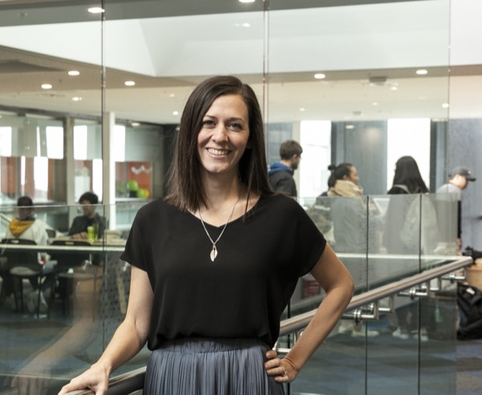

     

I study how teams create and maintain software products: how developers coordinate, who gets to take part, how developers understand users’ needs, and how the process is changing in the rapidly evolving technical landscape.

 

I’m a Professor of Software Engineering in the Department of Electrical, Computer, and Software Engineering at the University of Auckland, New Zealand, and a Rutherford Discovery Fellow. I lead the <a href="https://hasel.auckland.ac.nz/" target="_blank">Human Aspects of Software Engineering Lab (HASEL)</a>. I lead the <a href="https://engclusion.nz/" target="_blank">ENGclusion</a> research programme.

<h2 class="h4 mt-4">Research</h2>

I take a socio-technical view of software engineering. Software is built by people, and the social side of development shapes the results as much as the tools and code do. My work combines qualitative and quantitative methods, including mining software repositories, lab experiments, interviews, and surveys.

 

Current projects include:

<ul>
  <li><b>Impact of AI.</b> The rapid advancement of AI is dramatically changing the way we engineer software. We're studying how this impacts developers and what changes are needed to processes and tools in this new way of working.</li>
  <li><b>Keeping software dependencies up to date.</b> Updating to a new version of a library can fix security vulnerabilities, but it can also break the code that depends on it. We’re developing methods to automate these updates, including adapting code to breaking changes.</li>
  <li><b>Diversity and inclusion in software teams.</b> Women leave tech jobs at much higher rates than men. We’re studying what drives people away and which practices make software teams more inclusive.</li>
</ul>

Our research has attracted funding from the Royal Society Te Apārangi through a Rutherford Discovery Fellowship and the Marsden Fund, the Ministry of Business, Innovation, and Employment Endeavour Fund, the National Science Challenge's Science for Technological Innovation Fund, and Google.

 

See my <a href="/publications.html">publications</a>, <a href="/talks.html">talks</a>, and <a href="/service.html">service roles</a> for more details on my work. For student opportunities, see the <a href="/students.html">students</a> page or <a href="/contact.html">get in touch</a>.

 
<h2 class="h4 mt-4">Background</h2>
 

Before joining the University of Auckland, I was a lecturer at Auckland University of Technology and a postdoctoral fellow at the University of Victoria, Canada. Earlier, I spent eight years at Lockheed Martin as a software engineer and proposal manager.

 

I received my PhD from Drexel University in 2014, with a <a href="/publications/blincoe_thesis.pdf">dissertation</a> on helping software developers coordinate efficiently. I also hold an MS in Information Science from Pennsylvania State University and a BE from Villanova University.

 

I am  originally from Philadelphia, PA, USA. I currently live in Auckland, New Zealand with my husband, Adrian, and our two children.

