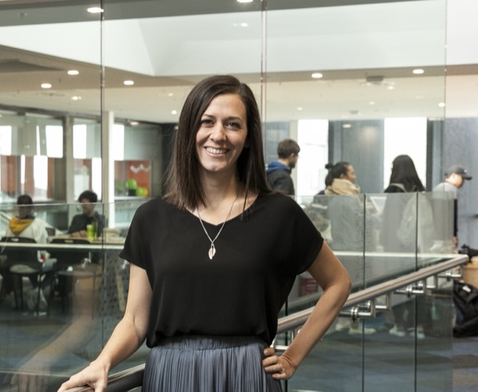

    

      

         
      

      
    
      <h1 class="text-primary mb-4">Kia ora, I'm Kelly Blincoe</h1>

      
I study how people create and maintain software systems. I am a Rutherford Discovery Fellow and a Professor of Software Engineering at the University of Auckland, New Zealand in the <a href="https://hasel.auckland.ac.nz/" target="_blank">Human Aspects of Software Engineering Lab (HASEL)</a>, in the Department of Electrical, Computer, and Software Engineering. I lead the <a href="https://engclusion.nz" target="_blank">ENGclusion</a> research programme.

      
<a href="/about.html" style="font-family: 'Homemade Apple', cursive; font-size: 150%;">More about me</a>

  

  <h2 class="h4 mt-5">Recent news</h2>
  <ul class="news list-unstyled">
  
    <li class="mb-2">
      {{ item.date | date: "%b %Y" }}
      
        {{ item.text | markdownify | remove: '
' | remove: '
' }}
        <a href="/publications.html#{{ item.pub }}">Details.</a>
      
    </li>
  
  </ul>

